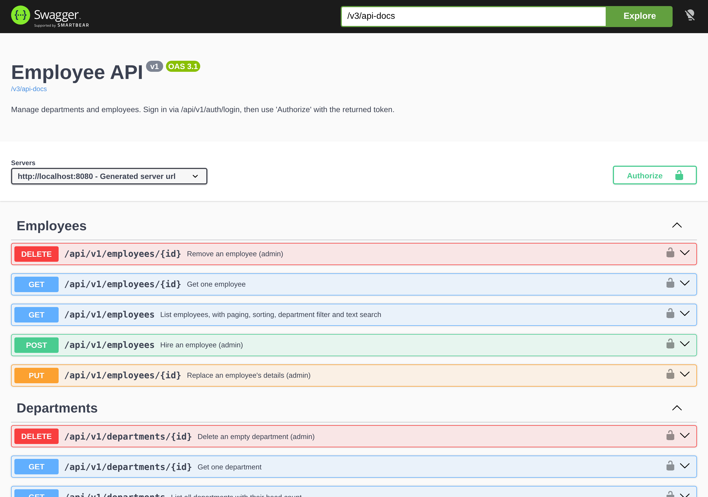

# Employee API

[](../../actions/workflows/ci.yml)


A REST API for managing departments and employees, built with **Spring Boot 4**, and tested the way a
QA engineer would: business rules unit-tested in isolation, and the real HTTP API exercised end to end
with **RestAssured** against a real **PostgreSQL** database in Docker (**Testcontainers**).



## Features

- **CRUD** for employees and departments, with `201 Created` + `Location`, `204 No Content` and `404`
- **Paging, sorting, filtering and search**:
  `GET /api/v1/employees?departmentId=2&search=chen&page=0&size=20&sort=salary,desc`
- **JWT authentication** (`POST /api/v1/auth/login`) with two roles: `VIEWER` can read, `ADMIN` can write
- **Validation** with every invalid field reported at once
- **Consistent errors**: every error is an [RFC 9457](https://www.rfc-editor.org/rfc/rfc9457)
  `application/problem+json` document, including 401 and 403
- **Business rules**: unique emails (case-insensitive), no deleting departments that still have staff,
  unknown department references rejected with `422`
- **PostgreSQL with Flyway migrations**: the schema is versioned; Hibernate only validates it
- **OpenAPI 3.1 docs** with Swagger UI, and a health endpoint for container orchestration

## Run it

Requirements: JDK 21+, Maven, Docker.

```bash
mvn -B package -DskipTests
```

```bash
docker compose up -d --build --wait
```

Then open http://localhost:8080/swagger-ui.html, call `POST /api/v1/auth/login`, and paste the token
into **Authorize**. Or use curl:

```bash
TOKEN=$(curl -s localhost:8080/api/v1/auth/login -H 'Content-Type: application/json' \
  -d '{"username":"admin","password":"Admin-Pass-2024!"}' | jq -r .accessToken)
```

```bash
curl -s "localhost:8080/api/v1/employees?sort=salary,desc" -H "Authorization: Bearer $TOKEN" | jq
```

Demo accounts (created at startup, configurable via `DEMO_ADMIN` / `DEMO_VIEWER`):

| User | Password | Role |
|---|---|---|
| `admin` | `Admin-Pass-2024!` | read and write |
| `viewer` | `Viewer-Pass-2024!` | read only |

The JWT signing key defaults to a clearly labelled development value. Set `JWT_SECRET` (base64, at
least 32 bytes) for anything beyond local use.

## Tests

```bash
mvn verify
```

Runs everything and writes a coverage report to `target/site/jacoco/index.html`. Docker must be
running, since the API tests start PostgreSQL in a container.

| Suite | Tests | What it checks |
|---|---|---|
| `AuthApiTest` | 7 | Token issue, wrong password, no user enumeration, missing or tampered token, viewer is read-only |
| `EmployeeApiTest` | 17 | Create/read/update/delete, Location header, paging + sorting + filtering, search, duplicate email (409), unknown department (422), every validation rule, malformed JSON |
| `DepartmentApiTest` | 4 | Lifecycle, unique names, cannot delete a department with staff, seeded data |
| `PlatformApiTest` | 3 | OpenAPI document, Swagger UI, health |
| `EmployeeServiceTest` | 5 | Business rules with Mockito, no Spring or database |

How the API tests are built:

- **Black-box.** The application starts on a random port, and RestAssured calls it over HTTP like
  any other client. Nothing is mocked.
- **Real database.** Testcontainers starts PostgreSQL 17, and the Flyway migrations run exactly as
  in production. An in-memory database would hide SQL differences.
- **Independent tests.** Every test creates its own departments and employees with unique names, so
  tests never depend on order or on each other.
- **Contract-level assertions.** Status codes, headers, error documents and exact field values are
  all asserted, not just "200 OK".

## Project structure

```
src/main/java/io/github/inarazahin/employees/
  auth/         login endpoint, JWT issuing, user accounts, demo users
  config/       security (JWT resource server, roles) and OpenAPI setup
  department/   entity, repository, service, controller, DTOs
  employee/     entity, repository (search query), service, controller, DTOs, paging
  error/        ApiException and the RFC 9457 problem-document handler
src/main/resources/
  application.yml          configuration (all secrets overridable by environment variables)
  db/migration/            Flyway schema and demo data
src/test/java/.../api/     RestAssured + Testcontainers API tests
src/test/java/.../unit/    Mockito unit tests
```

## History

This repository started as a beginner Spring Boot CRUD exercise (one `Employee` entity, endpoints
like `/emp/get/all`, compiled classes committed). Version 2 is a rewrite with security, a real
database, migrations, documentation, tests and CI.
